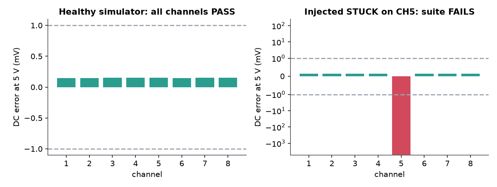

<p align="center">
  <picture>
    <source media="(prefers-color-scheme: dark)" srcset="assets/logo-dark.svg">
    
  </picture>
</p>

<p align="center">
  <b>Does every channel of the DAQ still measure what it should?</b><br>
  A pytest suite that checks an 8-channel voltage DAQ over SCPI/PyVISA: accuracy, noise, crosstalk and dropped samples, against a simulated instrument so it runs in CI.
</p>

<p align="center">
  <a href="https://github.com/Alifizz01/DAQProof/actions/workflows/ci.yml"></a>
  
  
  
</p>

<p align="center"></p>

> **Scope:** Simulated instrument only; limits are illustrative. Personal portfolio project, not affiliated with any employer.

---

## The problem

A measurement system drifts, a channel sticks, a block of samples goes missing. If nobody checks, every test result built on top is wrong. This suite checks the instrument itself, and CI proves it catches faults by injecting one and requiring the run to fail.

## Overview

A pytest suite that checks a multi-channel voltage DAQ over SCPI through PyVISA,
plus a small simulated instrument so the suite runs anywhere, including CI.

## What it does

- `daqsim/server.py`: simulated 8-channel DAQ/DMM on a raw TCP socket (SCPI, newline
  terminated). Models offset, gain error, Gaussian noise and channel crosstalk, and
  supports fault injection (`SIM:FAULT STUCK|DROP|NONE,(@ch)`). Out-of-range inputs
  read 9.9E37 (overload). Commands: `*IDN?`, `*RST`, `SYST:ERR?`, `SYST:CHAN?`,
  `CONF:VOLT:RANG`, `SAMP:RATE`, `SAMP:COUN`, `MEAS:VOLT?`, `FETC?`, and `SOUR:VOLT`,
  which stands in for an external calibrator setting the true input.
- `tests/`: session-scoped instrument connection, function-scoped channel
  configuration with cleanup, parametrized channels and ranges. Checks DC accuracy
  against an abs + rel limit, noise RMS, crosstalk in dB, sample-count completeness,
  overload reporting and SCPI error handling. Failure messages give channel, range,
  measured value and limit.
- `summary.py`: JUnit XML to a short Markdown table.
- CI (GitHub Actions): runs the suite against the simulator, then reruns it with an
  injected fault and requires it to fail, and uploads the JUnit reports.

## Run

```
pip install -r requirements.txt
pytest -q --junitxml=report.xml
python summary.py report.xml
```

Fault demo, which should produce failures on the faulty channel:

```
pytest -q --inject-fault STUCK:3
pytest -q --inject-fault DROP:2
```

The simulator can also run standalone: `python -m daqsim.server --port 5025`.

## Pointing it at a real instrument

```
pytest --visa-resource "TCPIP::192.168.1.50::5025::SOCKET"
```

Any VISA resource string works (`TCPIP::...::INSTR`, `USB0::...::INSTR`). Tests marked
`simulated` are skipped and tests marked `hardware` run. To do this for real you would
need to: map the SCPI commands to the instrument's actual command set, replace
`SOUR:VOLT` with control of a real calibrator or source, take limits from the
instrument's datasheet, and possibly switch from the `@py` backend to a vendor VISA.

## Limitations

- Simulated instrument only. Not run against a DEWETRON system or any physical DAQ
  hardware. The command set is a simplified SCPI-style dialect, not a vendor's.
- Tolerances are illustrative, not from a datasheet. The error model is simple
  (constant offset, gain, white Gaussian noise, linear crosstalk); no drift, thermal
  effects, settling, AC or frequency response.
- Sample rate is stored but does not shape the simulated signal.
